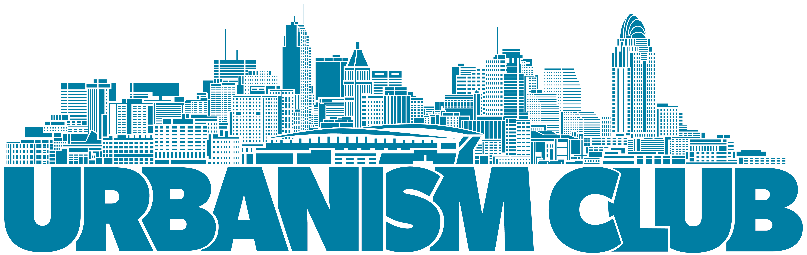

<div align="center">

<picture>
  <source media="(prefers-color-scheme: dark)" srcset="src/assets/urbanism-club-logo-inverted.png">
  
</picture>

### The website of the Urbanism Club at the University of Cincinnati

[](https://uc-urbanism.netlify.app)
[](https://astro.build)
[](https://decapcms.org)
[](LICENSE)

**[Visit the site](https://uc-urbanism.netlify.app)** · [Edit content](#editing-the-site-no-coding-needed) · [Run it locally](#run-it-locally) · [Contribute](CONTRIBUTING.md) · [Take over the site](#taking-over-the-site) · [Changelog](CHANGELOG.md)

</div>

---

The Urbanism Club is a Registered Student Organization at the University of Cincinnati. This is its website: a small,
fast, static site that club members edit in the browser, with no coding and no server to look after.

- **Open to everyone in the club.** Any club member or board member can contribute: you don't need to hold an
  office, and you don't need to code. Every heading, paragraph, link, photo and embed is a form field in the CMS.
- **Nothing to maintain.** Static pages, free hosting, no database, no secrets in the repository.
- **Built to be handed on.** Board turnover is expected; [Taking over the site](#taking-over-the-site) lists
  exactly who needs which access.

The text, photos and embeds came from the club's two earlier sites
([Canva](https://uc-urbanism.my.canva.site/), [Geocities](https://geocities.ws/uc_urbanism/)).

## Pages

| Address | What's there |
| --- | --- |
| [`/`](https://uc-urbanism.netlify.app/) | About Us: who we are, what urbanism is, goals, affiliates, leadership team |
| [`/connect/`](https://uc-urbanism.netlify.app/connect/) | QR codes, the mailing list (`#join`), events calendar (`#events`), Instagram, where we meet |
| [`/resources/`](https://uc-urbanism.netlify.app/resources/) | Proposals, Projects, and Plans |
| `404` | A branded "page not found" page |

Old `/events` and `/join` links redirect to the matching section of Connect (see [`netlify.toml`](netlify.toml)).

## Editing the site (no coding needed)

Go to **[uc-urbanism.netlify.app/admin](https://uc-urbanism.netlify.app/admin/)**, sign in with GitHub, edit, and
press **Publish**. The live site updates in about a minute.

| CMS section | What it edits | Files |
| --- | --- | --- |
| Site settings | Social and join links, QR codes, Analytics ID, Search Console token | `src/content/settings/site.yml` |
| Pages | Every heading, paragraph and embed address, page by page | `src/content/pages/*.yml` |
| Leadership | The Leadership Team (one entry per person, in order) | `src/content/leadership/*.yml` |
| Affiliate organizations | Logos and links in the Affiliates row | `src/content/affiliates/*.yml` |

**Anyone in the club can do this, board member or not.** All you need is a free GitHub account with **Write**
access to this repository: ask a maintainer or an officer, and the club's account adds you. Not sure about a
change, or just spotted a typo? Open an [issue](../../issues) or mention it at a meeting instead.

Changing code or design goes through a pull request: see [CONTRIBUTING.md](CONTRIBUTING.md).

## Run it locally

Needs [Node.js](https://nodejs.org) 22 or newer.

```bash
npm install
```

```bash
npm run dev
```

The site is at http://localhost:4321. To use the CMS against your local files, run this in a second terminal and
open http://localhost:4321/admin/index.html:

```bash
npm run cms
```

Before pushing, both of these must pass:

```bash
npm run build
```

```bash
npm test
```

`npm test` checks that the club's text, embeds and links are still on the right pages and that internal links are
well-formed.

> [!WARNING]
> Pushing to `main` deploys to the live site. There is no staging step.

### Where things are

```
src/content/        everything editable (YAML, plus photos and logos)
src/pages/          page templates
src/layouts/        shared layout: nav, SEO tags, footer, night theme
src/styles/         the one stylesheet
src/assets/         photos and backgrounds (optimized at build time)
public/admin/       Decap CMS
public/media/       QR code SVGs
scripts/            the content check behind `npm test`
```

[HANDOFF.md](HANDOFF.md) has the full maintainer notes: why things are the way they are, known issues, and what is
waiting on the board. [MAINTAINERS.md](MAINTAINERS.md) says who the maintainers are, what they pledge, and who may
merge what.

## Taking over the site

The site depends on a handful of accounts. Each should belong to **the club, not one person**, or have at least two
owners, so nothing is lost when someone graduates.

### Who needs what

| Role | Who | GitHub (this repo) | Netlify | Everything else |
| --- | --- | --- | --- | --- |
| **Contributor** | Any club member or board member who asks | **Write** | none | none |
| **Maintainer** | The people listed in [MAINTAINERS.md](MAINTAINERS.md), who review and merge code | **Write** | optional: team member, to read deploy logs | none |
| **Owner** | President plus one other officer, through the club's GitHub account | Sign-in to the **owner account** | **Owner** of the team that holds the site | Owner of everything in the table below |

Contributor access is for anyone in the club who asks; there is no vetting beyond being a member. For the other
two rows, give people the lowest one that covers what they do. Contributors never need Netlify.

A repository under a personal or club account has one owner; everyone else is a collaborator with Write, so the
difference between contributor and maintainer is the agreement in [MAINTAINERS.md](MAINTAINERS.md), not a GitHub
setting. Only the owner account can add or remove people.

### What the owner holds

| Thing | Where | What happens if it's lost |
| --- | --- | --- |
| This repository | GitHub | Nobody can edit or deploy |
| The Netlify site `uc-urbanism` | [app.netlify.com](https://app.netlify.com) | The site stays up but can't be changed or moved |
| The GitHub OAuth App for CMS sign-in | GitHub → Settings → Developer settings; its secret is stored in Netlify | Nobody can sign in at `/admin` |
| Google Analytics property | [analytics.google.com](https://analytics.google.com) | Visitor statistics are lost |
| The two Google Calendars on Connect | Google Calendar | The events calendar goes stale |
| The mailing-list Google Form and its Sheet | Google Forms | Signups are lost |
| The Adobe Fonts kit (the Gibson typeface) | [fonts.adobe.com](https://fonts.adobe.com) | Headings fall back to a system font |
| Instagram, GroupMe, LinkedIn, GetInvolvedUC | Each service | The links and QR codes point nowhere |

### Handover checklist

- [ ] Hand the incoming owner the sign-in to the club's GitHub account (update its recovery email and two-factor
      device), and add them as **Owner** on the Netlify team. Do this before the outgoing owner leaves.
- [ ] Update the maintainers table in [MAINTAINERS.md](MAINTAINERS.md).
- [ ] Give the incoming owner access to each item in the table above. Shared club accounts are best.
- [ ] Add any club or board member who wants to contribute as a **Write** collaborator; remove people who have
      left the club.
- [ ] If the repository moves to a new account or organization (*Settings → Transfer*), update `repo:` in
      [`public/admin/config.yml`](public/admin/config.yml), re-link the repository in Netlify, and move or recreate
      the OAuth App.
- [ ] If the site's address changes, update `site` in [`astro.config.mjs`](astro.config.mjs), the two URLs in
      `public/admin/config.yml`, the sitemap line in [`public/robots.txt`](public/robots.txt), and the OAuth App's
      homepage.

> [!NOTE]
> Don't add a branch-protection rule that requires pull requests on `main`: the CMS saves by committing straight
> to `main`, and that rule would lock every contributor out.

### First-time setup of CMS sign-in

Done once by an owner. Until it is done, nobody can sign in at `/admin` on the live site.

1. GitHub → *Settings → Developer settings → OAuth Apps → New OAuth App*.
   Homepage: `https://uc-urbanism.netlify.app`. Authorization callback URL: `https://api.netlify.com/auth/done`.
   Copy the Client ID and generate a Client Secret.
2. Netlify → the site → *Site configuration → Access & security → OAuth → Install provider → GitHub*.
   Paste the Client ID and Secret there. They are never stored in this repository.
3. Add each club or board member who wants to contribute as a collaborator with Write access
   (*Settings → Collaborators → Add people*).

## Mailing list

The site collects no email addresses itself. The "Join the mailing list" button on Connect opens a **club-owned
Google Form**, and responses collect in that form's Google Sheet. To set it up:

1. Create a Google Form from a shared club account with one required *Short answer* question, "Email", using
   *Response validation → Text → Email address*.
2. *Responses → Link to Sheets*, so signups land in a spreadsheet the board can share.
3. *Send → link icon → Shorten URL*, and copy the `https://forms.gle/…` link.
4. Paste it into **CMS → Pages → Connect → Join section: Google Form link**.

While that field is blank, the section says the list is coming and shows the GroupMe button instead. If the form is
made under a uc.edu account, decide on purpose whether *Restrict to users in University of Cincinnati* stays on: it
blocks alumni and community members.

## Search engines

`robots.txt` and `sitemap-index.xml` are generated automatically. To verify the site in Google Search Console,
choose the *HTML tag* method and paste the token into **CMS → Site settings → Google Search Console verification
token**.

## Security and privacy

- The repository holds no passwords, keys or tokens, and the build needs none. Keep it that way: never commit a
  `.env` file or an OAuth secret.
- The IDs you will find in `src/content/` (Google Analytics, calendar addresses, the GroupMe invite) are already
  visible to every visitor of the site.
- Found a problem? Open an [issue](../../issues), leaving out anything
  sensitive, or message the club through the [Connect page](https://uc-urbanism.netlify.app/connect/).
- Want a photo of yourself taken down? Same channels; it will be removed.

## License

| | |
| --- | --- |
| **Code** (templates, styles, scripts, configuration) | [MIT](LICENSE): use it for your own club's site |
| **Content** (club text, name, logos, photos, affiliate logos) | Not open-licensed: see [LICENSE-CONTENT.md](LICENSE-CONTENT.md) |

<div align="center">
<sub>Made in Cincinnati by members of the Urbanism Club.</sub>
</div>
